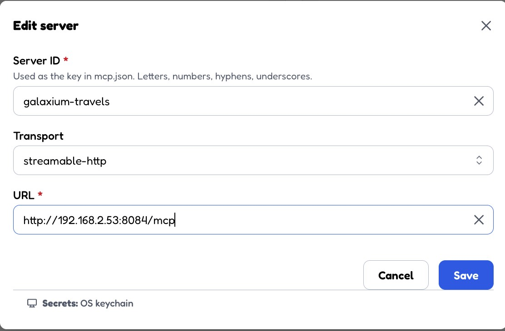
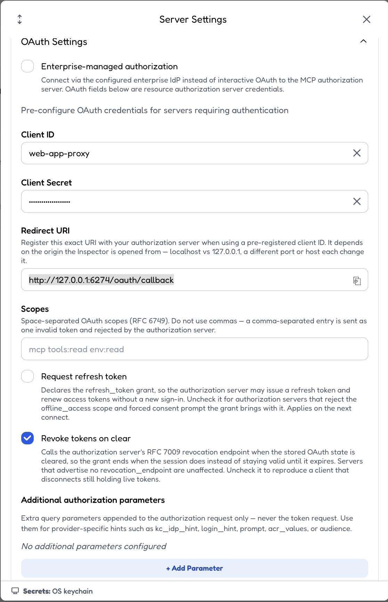

# 2-2. Manually Verify The OAuth2 MCP Server

Use this guide after starting the OAuth2 stack (section 1.4) from
[1-galaxium_setup.md](./1-galaxium_setup.md).

> **Infrastructure release:** This guide targets **`v6.1.1`** of
> [galaxium-travels-infrastructure-tsuedbro](https://github.com/thomassuedbroecker/galaxium-travels-infrastructure-tsuedbro).
> The compose file names, scripts, and ports may differ on other releases.

This guide talks directly to Keycloak and the MCP backend.
It does not go through the browser UIs.

The transport stays on `Streamable HTTP`. The auth mode is OAuth 2.0
`client_credentials` (the flow used by watsonx Orchestrate in guide
[4-2](./4-2-watsonx-orchestrate-adk-add-oauth2-mcp.md)).

## 2-2.1 What You Will Verify

- unauthenticated MCP access is rejected
- Basic Auth and invalid bearer tokens are rejected
- the MCP OAuth metadata does not advertise the implicit flow
- a `client_credentials` token can be requested from Keycloak
- authenticated `initialize`, `tools/list`, and `tools/call(list_flights)` succeed

## 2-2.2 Prerequisites

- the OAuth2 stack is running (MCP on port `8084`, Keycloak on port `8086`)
- `curl`
- `jq`
- the Basic Auth stack is **stopped** (both stacks use port `8084`, how to stop it is described in section 2-2.3)

## 2-2.3 Prepare The Working Folder

```sh
cd infrastructure/galaxium-travels-infrastructure-tsuedbro
export OAUTH_DIR=local-container/booking_system_mcp_oauth2_no_implicit_flow
```

Stop the Basic Auth stack first. Both stacks publish port `8084`, so only one can run at a time.
Check what is running:

```sh
docker ps --format 'table {{.Names}}\t{{.Ports}}' | grep -E '8084|8086|8082|8083|8085'
```

If you see `booking_system_mcp_basic_vm` (or other `*_basic_vm` containers), stop the Basic Auth stack:

```sh
docker compose --env-file local-container/basic-auth.env \
  -f local-container/docker_compose.basic-auth-vm.yaml \
  down --remove-orphans
```

If you started the local-only variant, use `local-container/docker_compose.basic-auth.yaml` instead.
With Podman, replace `docker compose` with `podman compose`.

Confirm that port `8084` is free (no output expected):

```sh
lsof -nP -iTCP:8084 -sTCP:LISTEN
```

If you have not created the env file yet (section 1.4.1):

```sh
cp ${OAUTH_DIR}/mcp.env.template ${OAUTH_DIR}/mcp.env
```

Load the settings and start the stack if it is not running:

```sh
source ${OAUTH_DIR}/mcp.env
bash ${OAUTH_DIR}/start.sh
```

Keycloak needs about 30 seconds on first start before it issues tokens.

Defaults from `mcp.env`:

- `KEYCLOAK_PUBLIC_BASE_URL`: `http://localhost:8086` (or `http://<LAN IP>:8086` for the Developer Edition setup)
- `MCP_PUBLIC_BASE_URL`: `http://localhost:8084` (or `http://<LAN IP>:8084`)
- client ID: `web-app-proxy`
- client secret: `web-app-proxy-secret`

> **Note:** The token `iss` claim is built from `KEYCLOAK_PUBLIC_BASE_URL`.
> Always request the token from that same URL, otherwise the MCP server rejects it.

Quick health checks:

```sh
curl -fsS http://localhost:8084/ | head
curl -fsS "${KEYCLOAK_PUBLIC_BASE_URL}/realms/galaxium/.well-known/openid-configuration" | jq .issuer
```

Optional the full information:

```sh
curl -fsS http://localhost:8084/ | head
curl -fsS "${KEYCLOAK_PUBLIC_BASE_URL}/realms/galaxium/.well-known/openid-configuration" | jq .
```

## 2-2.4 Confirm That Unauthenticated MCP Access Fails

```sh
curl -i \
  -X POST http://localhost:8084/mcp \
  -H 'Content-Type: application/json' \
  -H 'Accept: application/json, text/event-stream' \
  -H 'MCP-Protocol-Version: 2025-11-25' \
  -d '{"jsonrpc":"2.0","id":1,"method":"initialize","params":{"protocolVersion":"2025-11-25","capabilities":{},"clientInfo":{"name":"manual-oauth2-check","version":"1.0.0"}}}'
```

Expected result (this is the correct outcome, the server is protected):

- HTTP `401 Unauthorized`
- a `WWW-Authenticate` header with the `Bearer` scheme

Optional: a Basic header or an invalid token must be rejected as well:

```sh
curl -s -o /dev/null -w '%{http_code}\n' \
  -X POST http://localhost:8084/mcp \
  -H 'Content-Type: application/json' \
  -H 'Accept: application/json, text/event-stream' \
  -H 'Authorization: Bearer not-a-valid-jwt' \
  -d '{"jsonrpc":"2.0","id":1,"method":"initialize","params":{}}'
```

Expected result: `401`.

## 2-2.5 Check The OAuth Metadata

```sh
curl -fsS http://localhost:8084/.well-known/oauth-authorization-server \
  | jq '{response_types_supported, grant_types_supported}'
```

Expected result:

- `response_types_supported` is `["code"]`
- `grant_types_supported` contains `client_credentials` and `authorization_code`
- `grant_types_supported` does **not** contain `implicit`

watsonx Orchestrate does not support the implicit flow.

## 2-2.6 Request An Access Token

```sh
ACCESS_TOKEN="$(curl -fsS -X POST \
  "${KEYCLOAK_PUBLIC_BASE_URL}/realms/galaxium/protocol/openid-connect/token" \
  -u "${OIDC_CLIENT_ID}:${OIDC_CLIENT_SECRET}" \
  -d grant_type=client_credentials | jq -r .access_token)"
```

The helper script from the infrastructure repository does the same:

```sh
ACCESS_TOKEN="$(bash ${OAUTH_DIR}/get-token.sh)"
```

Optional check of the issuer:

```sh
echo "${ACCESS_TOKEN}" | cut -d. -f2 | tr '_-' '/+' | base64 -d 2>/dev/null | jq '{iss, aud, exp}'
```

Expected result: `iss` equals `${KEYCLOAK_PUBLIC_BASE_URL}/realms/galaxium`.

## 2-2.7 Run `initialize` With The Bearer Token

```sh
curl -i \
  -X POST http://localhost:8084/mcp \
  -H 'Content-Type: application/json' \
  -H 'Accept: application/json, text/event-stream' \
  -H 'MCP-Protocol-Version: 2025-11-25' \
  -H "Authorization: Bearer ${ACCESS_TOKEN}" \
  -d '{"jsonrpc":"2.0","id":1,"method":"initialize","params":{"protocolVersion":"2025-11-25","capabilities":{},"clientInfo":{"name":"manual-oauth2-check","version":"1.0.0"}}}'
```

Expected result:

- HTTP `200`
- an `mcp-session-id` response header
- a response body containing `serverInfo`

Copy the returned session id into:

```sh
export SESSION_ID='<paste-the-mcp-session-id-here>'
```

## 2-2.8 Run `tools/list`

```sh
curl -sS \
  -X POST http://localhost:8084/mcp \
  -H 'Content-Type: application/json' \
  -H 'Accept: application/json, text/event-stream' \
  -H 'MCP-Protocol-Version: 2025-11-25' \
  -H "MCP-Session-Id: ${SESSION_ID}" \
  -H "Authorization: Bearer ${ACCESS_TOKEN}" \
  -d '{"jsonrpc":"2.0","id":2,"method":"tools/list","params":{}}'
```

Expected tools:

- `list_flights`
- `book_flight`
- `get_bookings`
- `cancel_booking`
- `register_user`
- `get_user_id`

## 2-2.9 Run `tools/call(list_flights)`

```sh
curl -sS \
  -X POST http://localhost:8084/mcp \
  -H 'Content-Type: application/json' \
  -H 'Accept: application/json, text/event-stream' \
  -H 'MCP-Protocol-Version: 2025-11-25' \
  -H "MCP-Session-Id: ${SESSION_ID}" \
  -H "Authorization: Bearer ${ACCESS_TOKEN}" \
  -d '{"jsonrpc":"2.0","id":3,"method":"tools/call","params":{"name":"list_flights","arguments":{}}}'
```

Expected result:

- HTTP `200`
- a payload with the available flights

## 2-2.10 Optional: Run The Automated Check

The infrastructure repository bundles all of the above checks in one script:

```sh
bash ${OAUTH_DIR}/verify.sh
```

## 2-2.11 Optional: Open MCP Inspector UI

```sh
echo "URL: ${MCP_PUBLIC_BASE_URL}/mcp"
export DANGEROUSLY_OMIT_AUTH=true
npx -y @modelcontextprotocol/inspector@latest
```

Open the Inspector at `http://127.0.0.1:6274` or `http://localhost:6274`.
The redirect URI in the OAuth settings must be one of the URIs registered in the Keycloak realm:

- `http://localhost:6274/oauth/callback`
- `http://127.0.0.1:6274/oauth/callback`

Add a new server (example image):



Use these Inspector server settings:

- Name: `galaxium-travels`
- Transport: `Streamable HTTP`
- URL: `${MCP_PUBLIC_BASE_URL}/mcp`, for example `http://localhost:8084/mcp`, or `http://<LAN IP>:8084/mcp` when `mcp.env` uses the LAN IP (section 1.4.1). Open the Inspector itself on `localhost` or `127.0.0.1`, because only those redirect URIs are registered in Keycloak.

In **Server Settings -> OAuth Settings** enter:

| Field | Value |
|---|---|
| Enterprise-managed authorization | unchecked |
| Client ID | `web-app-proxy` |
| Client Secret | `web-app-proxy-secret` |
| Redirect URI | keep the default, `http://127.0.0.1:6274/oauth/callback` |
| Scopes | leave empty |
| Request refresh token | **unchecked** (see the note below) |
| Revoke tokens on clear | keep the default (checked) |
| Additional authorization parameters | none |



> **Important:** Uncheck **Request refresh token**. It makes the Inspector request the
> `offline_access` scope, and the demo realm does not allow offline tokens for `demo-user`
> or `web-app-proxy`. Keycloak then fails the token exchange with
> `Offline tokens not allowed for the user or client`, and the Inspector shows
> *Re-authentication required*. The access token is short-lived, click **Connect** again when it expires.

Click **Connect**. The Inspector discovers Keycloak through
`/.well-known/oauth-protected-resource`, opens the Keycloak login, and uses
`authorization_code` with PKCE. Log in with:

- username: `demo-user`
- password: `demo-user-password`

> **Release note:** Releases before `v6.1.1` fail in the Inspector with
> `Issuer mismatch in authorization server metadata (RFC 8414 §3.3): expected "http://localhost:8084", received "http://localhost:8086/realms/galaxium"`.
> The MCP server listed itself in `authorization_servers` of
> `/.well-known/oauth-protected-resource`. `v6.1.1` advertises only the Keycloak issuer.
> Check the metadata:
>
> ```sh
> curl -fsS http://localhost:8084/.well-known/oauth-protected-resource | jq .authorization_servers
> ```
>
> Expected result: only `["${KEYCLOAK_PUBLIC_BASE_URL}/realms/galaxium"]`.
> If you still see the MCP URL, check out `v6.1.1` (section 1.2 of
> [1-galaxium_setup.md](./1-galaxium_setup.md)) and rebuild the container:
>
> ```sh
> docker compose -f ${OAUTH_DIR}/docker_compose.yaml up --build -d booking_system_mcp
> ```

Alternative without the browser login: skip the OAuth settings and set the Custom Header JSON to
`{"Authorization":"Bearer YOUR_ACCESS_TOKEN"}`. Replace `YOUR_ACCESS_TOKEN` with `${ACCESS_TOKEN}`.
Access tokens are short-lived, request a new one when the Inspector starts returning `401`.

## 2-2.12 Stop The OAuth2 Stack

When you are done, stop the OAuth2 stack (MCP server and Keycloak):

```sh
docker compose -f ${OAUTH_DIR}/docker_compose.yaml down --remove-orphans
```

Confirm that nothing listens on the ports anymore (no output expected):

```sh
lsof -nP -iTCP:8084 -iTCP:8086 -sTCP:LISTEN
```

To go back to the Basic Auth stack (guide `2-1`), start it again with the command from section 2.3 of that guide.

## 2-2.13 Common Problems

- `Re-authentication required` / `Offline tokens not allowed for the user or client`
  - uncheck **Request refresh token** in the Inspector OAuth settings (section 2-2.11) and connect again
- `Issuer mismatch in authorization server metadata (RFC 8414 §3.3)`
  - you run an infrastructure release before `v6.1.1`, check out `v6.1.1` and rebuild, see the release note in section 2-2.11
- `401` without a token
  - expected, send `Authorization: Bearer <token>`
- `401` with a bearer token
  - the token expired, request a new one
  - the token was requested from a different URL than `KEYCLOAK_PUBLIC_BASE_URL` (issuer mismatch)
- token request fails or the connection is refused
  - Keycloak needs about 30 seconds after the first start, retry the health check from 2-2.3
- `200` on `initialize`, but `tools/list` fails
  - reuse the exact `mcp-session-id` from the `initialize` response
- `localhost` works but watsonx Orchestrate cannot connect
  - the Developer Edition runs in a VM, set `KEYCLOAK_PUBLIC_BASE_URL` and `MCP_PUBLIC_BASE_URL` to the host LAN IP in `mcp.env` (section 1.4.1) and restart the stack
- port `8084` already in use
  - stop the Basic Auth stack as described in section 2-2.3, then run `lsof -nP -iTCP:8084 -sTCP:LISTEN` to find any other process still using the port

### [Home](./README.md)
